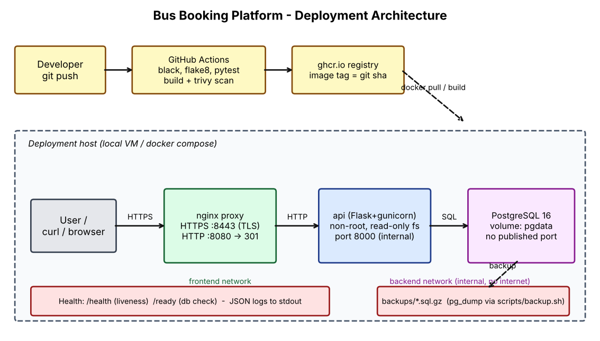

# Bus Booking API - Cloud Deployment & CI/CD

**Student:** Tanish  |  **Reg. no:** 12401986 |  **Role:** DevOps & Cloud Engineering
**Project:** Cloud Deployment & CI/CD - Bus Booking Platform (Algions AI Labs)

This project is a small bus trip + seat reservation API. The main goal is **not the app itself**,
it is how I build, ship, run, monitor, back up and recover it.



## What is in this repo

| Path | What it is |
|---|---|
| `app/` | Flask API (`main.py`) and database code (`db.py`) |
| `tests/` | 20 automated API tests (pytest) |
| `Dockerfile` | multi-stage build, runs as non-root user, has a healthcheck |
| `docker-compose.yml` | api + PostgreSQL + nginx proxy, with volume and health checks |
| `nginx/nginx.conf` | HTTPS reverse proxy, http -> https redirect |
| `.github/workflows/ci.yml` | CI: black, flake8, pytest, docker build, trivy scan, push image |
| `scripts/` | cert, backup, restore, rollback, smoke test, failure drill |
| `docs/RUNBOOK.md` | operations runbook (deploy, restart, logs, backup, incident) |
| `evidence/` | test output, conflict demo, logs, and the places for my docker evidence |

## API

| Method | Path | What it does |
|---|---|---|
| GET | `/health` | liveness - app is running (no db check) |
| GET | `/ready` | readiness - checks the database, returns 503 if db is down |
| GET | `/routes` | routes with their stops |
| GET | `/trips?route_id=1&date=YYYY-MM-DD` | list trips |
| GET | `/trips/<id>/seats` | seat map (40 seats, AVAILABLE/BOOKED) |
| POST | `/bookings` | create booking, returns PNR |
| GET | `/bookings/<pnr>` | ticket details / status |
| POST | `/bookings/<pnr>/cancel` | cancel (seat becomes free again) |

Example booking body:
```json
{"trip_id": 1, "seat_no": 5, "travel_date": "2026-11-14",
 "boarding_stop": "Ludhiana", "drop_stop": "Delhi",
 "passenger": {"name": "Ravi Kumar", "age": 24, "phone": "9876543210"}}
```
(`travel_date` must equal the trip's date. Seed trips are created for the next 10 days.)

### How double booking is prevented
A Python "is the seat free?" check is not safe when two requests arrive together. So the
database has a **partial unique index** on `(trip_id, seat_no) WHERE status='CONFIRMED'`.
If two requests race, the DB lets one insert win and the other fails with an integrity error,
which the API turns into **HTTP 409** (and no PNR is created). A cancelled booking is not
'CONFIRMED' so the seat can be booked again.

## Run it (clean machine)

Needs: Docker + Docker Compose, openssl, git.

```bash
git clone <repo-url> && cd bus-booking-devops
cp .env.example .env              # then edit POSTGRES_PASSWORD
./scripts/gen-cert.sh             # self-signed cert for HTTPS
docker compose up -d --build
docker compose ps                 # wait until all are "healthy"
./scripts/smoke-test.sh           # health, ready, booking, conflict
```
Open `https://localhost:8443/routes` (browser warning is expected for a self-signed cert;
use `curl -k`).

### Run without Docker (dev)
```bash
pip install -r requirements-dev.txt
pytest                                            # uses SQLite, no setup needed
AUTO_INIT_DB=1 flask --app "app.main:app_factory()" run
```

## Environment variables

| Variable | Used by | Meaning |
|---|---|---|
| `POSTGRES_USER` / `POSTGRES_PASSWORD` / `POSTGRES_DB` | db, api | database credentials (in `.env`, not committed) |
| `APP_VERSION` | compose, api | image tag; shown in `/health` |
| `HTTPS_PORT` / `HTTP_PORT` | proxy | published host ports (default 8443 / 8080) |
| `DATABASE_URL` | api | built by compose from the values above |
| `LOG_LEVEL` | api | INFO by default |
| `AUTO_INIT_DB` | api | `1` = create tables on startup (only for dev/CI) |

## Port map

| Port | Who | Exposed to host? |
|---|---|---|
| 8443 -> 443 | nginx (HTTPS) | yes |
| 8080 -> 80 | nginx (redirect to https) | yes |
| 8000 | api (gunicorn) | **no**, only inside docker network |
| 5432 | postgres | **no**, only on internal `backend` network |

## Security choices
- container runs as non-root user (uid 10001), `read_only` filesystem, `cap_drop: ALL`, `no-new-privileges`
- database is on an `internal` docker network: not reachable from the host or internet
- no secrets in git: `.env` and certs are in `.gitignore`, only `.env.example` is committed
- CI uses the built-in `GITHUB_TOKEN` with minimal permissions, no personal tokens
- Trivy scans the image in CI for HIGH/CRITICAL issues
- nginx: TLS 1.2+, HSTS, `server_tokens off`

## CI/CD
On every push / PR the workflow runs: **black -> flake8 -> pytest -> docker build -> trivy -> container smoke test**.
On push to `main` it also pushes the image to `ghcr.io/<owner>/bus-booking-api` tagged with the
short git SHA (and `latest`). The image digest is written in the run summary.
Deployment is manual and simple: set `APP_VERSION` in `.env` and run `docker compose up -d`.

## Rollback
Short version (details in `docs/RUNBOOK.md`):
```bash
./scripts/rollback.sh <previous-tag>      # e.g. ./scripts/rollback.sh a1b2c3d
curl -k https://localhost:8443/health     # version should show the old tag
```
If the problem is bad data (not bad code), use `./scripts/restore.sh backups/<file>.sql.gz`.
The schema has only `CREATE IF NOT EXISTS`, so rolling back the image is safe, no migrations to undo.

## Known limitations / assumptions (being honest)
- "Cloud" deployment is a local docker-compose stack (allowed by the brief), TLS is self-signed.
- Booking is one seat per request; no payment, no user login, no authentication on the API.
- Prices/fare, seat layout and seed data are simple demo data.
- Metrics (Prometheus) not done - stretch goal. Only health, readiness and JSON logs.
- Trivy step only reports (`exit-code: 0`), it does not fail the pipeline yet.
- No database migration tool (Alembic); schema is created by `app/db.py`.
- Tests run on SQLite; the same SQL works on PostgreSQL, but the Postgres path is verified
  only through docker-compose (see `evidence/`).
- Backups are manual (script); a cron job is suggested in the runbook but not set up.
