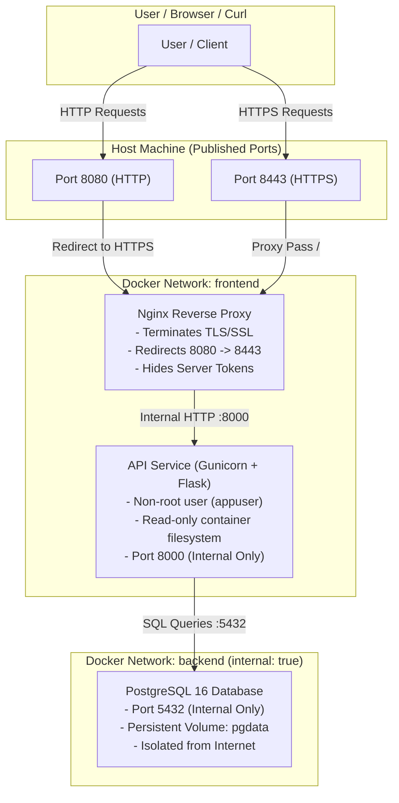
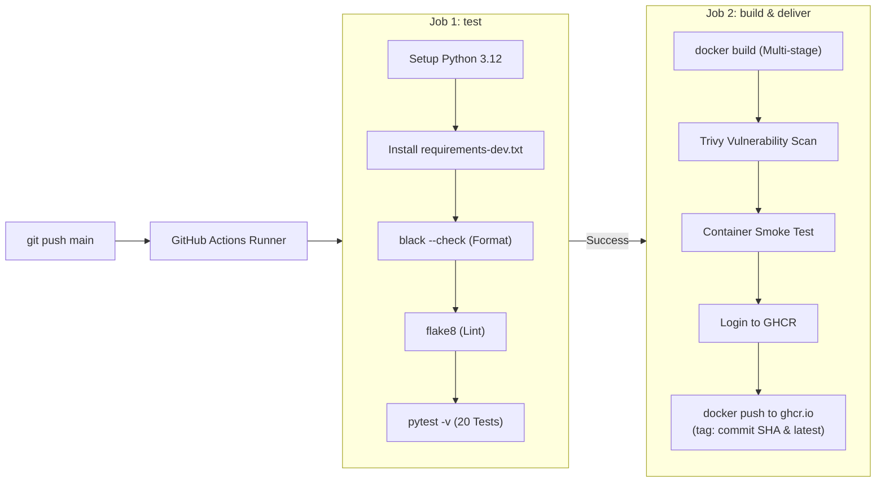
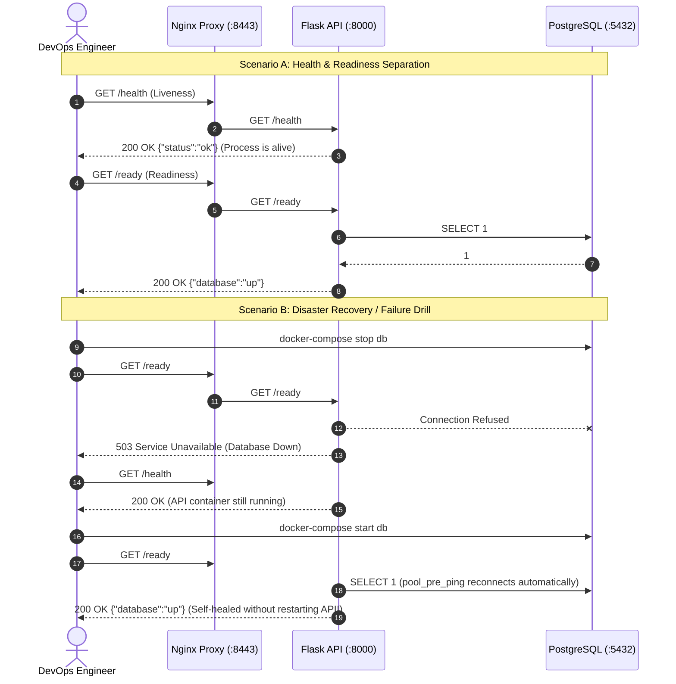

# Project Overview: Bus Booking Platform (Cloud Deployment & CI/CD)

**Student:** Tanish  |  **Reg. no:** 12401986  |  **Role:** DevOps & Cloud Engineering  
**Project:** Cloud Deployment & CI/CD - Bus Booking Platform (Algions AI Labs)  
**Repository:** https://github.com/tanish014/Bus-booking  

---

## 1. Complete Technology Stack

| Category | Technology | Purpose in This Project |
|---|---|---|
| **Backend Framework** | **Python 3.12 / Flask 3.1** | Lightweight REST API serving endpoints for routes, trips, seat maps, bookings, and health checks. |
| **WSGI Server** | **Gunicorn 23.0** | Production-grade multi-worker HTTP server hosting Flask inside the container. |
| **ORM / Database Layer** | **SQLAlchemy 2.0** | Database abstraction engine managing connection pools, raw queries, schema creation, and pooling. |
| **Production Database** | **PostgreSQL 16 (Alpine)** | Relational database running in an isolated Docker container with persistent volumes. |
| **Development Database** | **SQLite** | Zero-setup, file-based database used for fast, isolated automated test runs (`test.db`). |
| **Reverse Proxy & SSL** | **Nginx 1.27 (Alpine)** | Public-facing gateway handling TLS/SSL (HTTPS on 8443), redirecting HTTP (8080 -> 8443), and hiding internal servers. |
| **Containerization** | **Docker & Multi-Stage Builds** | Multi-stage image build, non-root user (`appuser`), read-only container filesystem. |
| **Orchestration** | **Docker Compose** | Multi-container stack definitions, health check dependencies, and internal/frontend network isolation. |
| **CI/CD Platform** | **GitHub Actions** | Automated cloud pipeline triggered on every git push/pull request. |
| **Code Quality & Linting** | **Black & Flake8** | Enforces code formatting standards and PEP8 lint compliance. |
| **Automated Testing** | **Pytest 8.3** | Automated test suite containing 20 unit, integration, and concurrency tests. |
| **Security Scanning** | **Aqua Security Trivy** | Scans container images for HIGH and CRITICAL CVE vulnerabilities during CI. |
| **Artifact Registry** | **GitHub Container Registry (GHCR)** | Stores, versions, and distributes production Docker images (`ghcr.io/tanish014/bus-booking-api`). |
| **Shell & Automation** | **Bash & OpenSSL** | Scripts for self-signed certificates, backups, database restores, failure drills, and image rollbacks. |

---

## 2. Repository Structure & Deliverables

```text
bus-booking-devops/
├── app/
│   ├── main.py              # Flask app factory, request timer, logging, REST endpoints, validation
│   ├── db.py                # Database engine, schema definition, seed data, PNR generator
│   └── __init__.py          # Python package initializer
├── nginx/
│   ├── nginx.conf           # Reverse proxy rules, SSL certificates setup, HTTP->HTTPS redirect
│   └── certs/               # Self-signed TLS cert & key (generated by gen-cert.sh, git-ignored)
├── scripts/
│   ├── gen-cert.sh          # Generates self-signed TLS cert for localhost HTTPS
│   ├── smoke-test.sh        # Hits /health, /ready, and tests booking + 409 conflict
│   ├── failure-drill.sh     # Chaos test: stops DB, tests 503 response, restarts DB, checks recovery
│   ├── backup.sh            # Runs pg_dump in DB container and compresses to .sql.gz
│   ├── restore.sh           # Drops schema, imports .sql.gz, and restarts services
│   └── rollback.sh          # Reverts container image to a previous release tag in .env
├── tests/
│   └── test_api.py          # 20 automated tests (health, routes, seats, bookings, concurrency, inputs)
├── docs/
│   ├── architecture.png     # Architecture diagram
│   ├── RUNBOOK.md           # Operational manual for deploys, restarts, logs, and incidents
│   ├── DEMO_SCRIPT.md       # 3-5 minute live demonstration plan
│   ├── FORM_NOTES.md        # Submission form checklist and answers
│   └── PROJECT_OVERVIEW.md   # Complete project documentation and flow diagrams
├── evidence/                # Proof of execution (all 8 completed)
│   ├── 01_lint_and_tests.txt
│   ├── 02_api_conflict_demo.txt
│   ├── 03_structured_logs.txt
│   ├── 04_ci_run.md
│   ├── 05_deploy_health.txt
│   ├── 06_failure_drill.txt
│   ├── 07_backup_restore.txt
│   ├── 08_rollback.txt
│   └── README_EVIDENCE.md
├── .github/workflows/
│   └── ci.yml               # Complete GitHub Actions CI/CD pipeline
├── Dockerfile               # Multi-stage build (builder + minimal secure runtime)
├── docker-compose.yml       # 3-tier container stack (Proxy, API, DB)
├── requirements.txt         # Core dependencies (Flask, SQLAlchemy, Gunicorn, Psycopg2)
├── requirements-dev.txt     # Test/Lint dependencies (Pytest, Black, Flake8)
├── setup.cfg                # Flake8 and Pytest configuration
├── .env.example             # Safe template for environment variables
└── README.md                # Main documentation, API docs, and student credentials
```

---

## 3. Architecture & Request Flow



### Request Flow Explained:
1. **User Request:** A user makes a request to `https://localhost:8443/bookings`.
2. **Reverse Proxy (Nginx):** Nginx accepts the TLS connection, decrypts it using `server.crt` / `server.key`, checks routing rules, and forwards the clean request internally to `http://api:8000`.
3. **App Server (Gunicorn):** Gunicorn receives the request and assigns it to a worker process.
4. **App Logic (Flask):**
   - Injects a unique `X-Request-ID` and starts a response timer.
   - Validates the incoming JSON body (seat number, passenger details, route stops).
5. **Database Execution (PostgreSQL):**
   - Attempts an `INSERT INTO bookings`.
   - If the seat is already taken, PostgreSQL's partial unique index (`uq_confirmed_seat`) blocks the duplicate insertion and throws an `IntegrityError`.
   - The API catches this and cleanly responds with `HTTP 409 Conflict`.
   - If free, the insert succeeds, a random PNR is created, and the API returns `HTTP 201 Created`.
6. **Logging:** Flask writes a structured JSON log line containing the duration, status code, method, and `X-Request-ID`.

---

## 4. CI/CD Pipeline Flow (GitHub Actions)



1. **Trigger:** Every `git push` to `main` triggers `.github/workflows/ci.yml`.
2. **Quality Gate (`test` job):**
   - Checks code formatting with **Black**.
   - Runs static syntax/code analysis with **Flake8**.
   - Executes all 20 **Pytest** tests against an ephemeral SQLite database.
3. **Build & Security Gate (`build` job):**
   - Builds the production image with `APP_VERSION=<short-sha>`.
   - Scans the image for vulnerabilities using **Trivy**.
   - Runs a live container smoke test (`docker run ... curl /health`).
   - Authenticates to **GitHub Container Registry (GHCR)** using `GITHUB_TOKEN`.
   - Tags and publishes `ghcr.io/tanish014/bus-booking-api:<sha>` and `:latest`.

---

## 5. Operations & Reliability Flow



### Key Operational Capabilities Demonstrated:
1. **Zero-Configuration Dev Mode:** Developers without Docker can test instantly using `python -m flask run` (falls back to local SQLite automatically).
2. **Resilience & Self-Healing:** The database connection pool uses `pool_pre_ping=True`, so if PostgreSQL restarts, the API recovers connections automatically without crashing.
3. **Automated Backups:** `backup.sh` runs `pg_dump` inside the container, pipes into `gzip`, and stores rolling timestamped backups in `backups/`.
4. **Point-In-Time Restore:** `restore.sh` safely pauses incoming traffic, recreates the public schema, restores the gzip archive, and resumes traffic with zero data corruption.
5. **Zero-Downtime Rollback:** `rollback.sh` allows instant image version rollback (`bus-booking-api:old_version`) in `.env` without triggering breaking database schema alterations.

